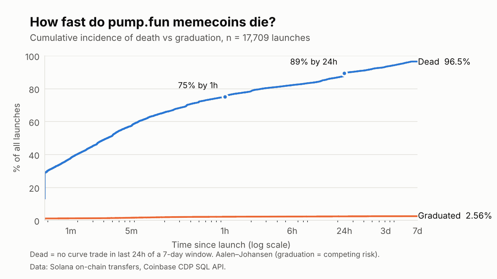
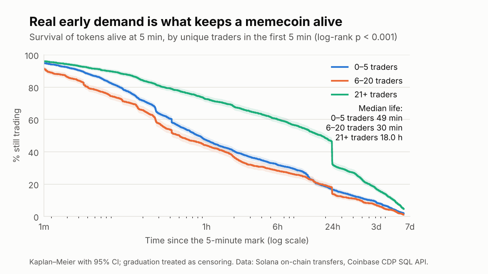
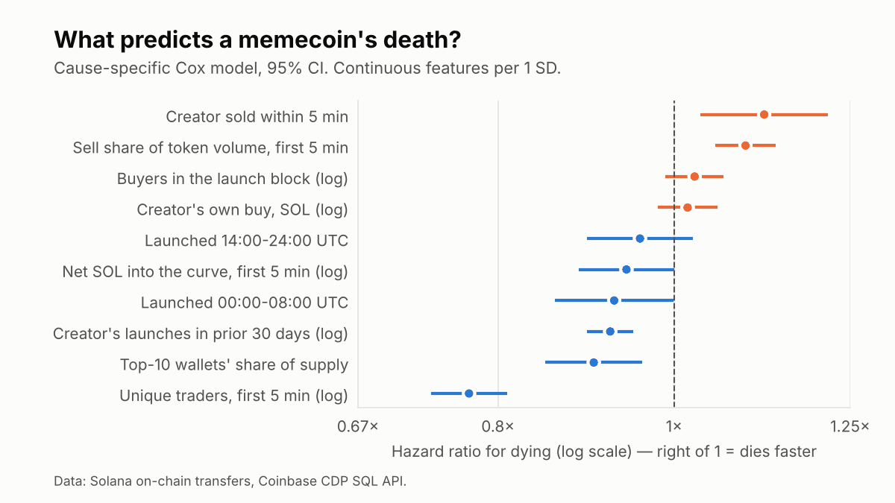
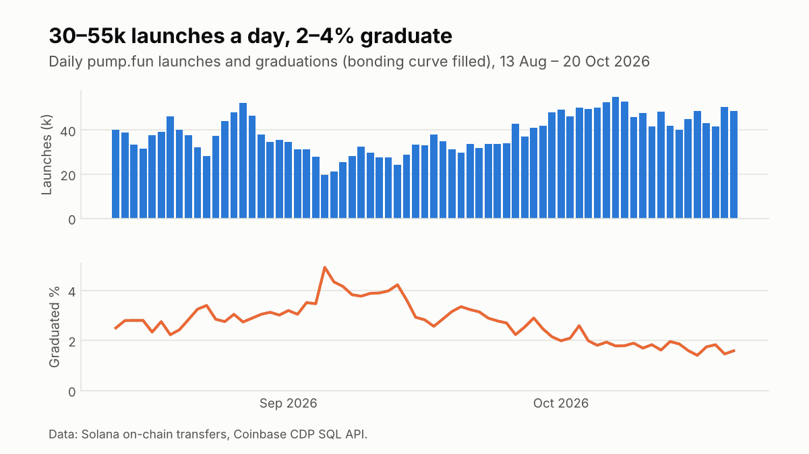

# How long do memecoins live? A survival analysis of pump.fun launches


Roughly 40,000 tokens are launched on [pump.fun](https://pump.fun) (Solana) every day. I followed **every launch from 1–7 October 2026 (352,621 tokens)** for seven days to measure how quickly they die, how few "graduate", and which signals in a token's first five minutes predict its death. The tools are the ones used in medical and credit-risk survival studies.

## Key findings

| | |
|---|---|
| **57%** | of launches stop trading within **5 minutes** |
| **75%** | are dead within **1 hour**; **89%** within 24 hours; **97%** within 7 days |
| **2.5%** | ever fill the bonding curve ("graduate"), and **88%** of those do it in the first hour |
| **14%** | never get more than a single trade |
| **18 h vs ~40 min** | median remaining life of tokens with 21+ unique traders in the first 5 minutes vs those with 20 or fewer |



**1. Most launches never get going.** Death is front-loaded: more than half are dead before a human could finish reading the token's page.

**2. Real early demand is the strongest survival signal.** The number of *distinct* wallets trading in the first 5 minutes is by far the strongest predictor (hazard ratio 0.77 per standard deviation). Tokens with 21+ traders live a median of 18 hours; those with fewer live well under an hour.



**3. The famous "dev sold" red flag is weaker than people think.** The creator sells within 5 minutes in 56% of tokens that survive that long. On its own it makes no significant difference to survival (log-rank p = 0.15). After controlling for demand it raises the death hazard by only about 12%.

**4. Some findings go against intuition.** Tokens from *serial* deployers (more launches in the prior 30 days) live slightly *longer* (HR 0.92), and higher top-10 holder concentration is mildly protective (HR 0.90). Both are consistent with experienced or bot-assisted launchers who seed early activity. These are associations, not causes.



**5. A 24-hour cliff.** A cluster of high-activity tokens stops trading **23.5–23.8 hours** after launch, whatever the time of day they launched (visible as the drop in the green curve above). This is consistent with fixed-length "24h volume bot" campaigns switching off. It is a hypothesis, not a proven cause.

**6. "Mayhem Mode" launches do worse.** About 24% of launches use pump.fun's 2bn-supply Mayhem Mode. They die faster (81% dead within 1 hour vs 73% for standard launches) and graduate less often (2.2% vs 2.6%).

**7. The first 5 minutes are informative but not decisive.** A logistic model using only first-5-minute features predicts death within 24h with an out-of-sample **AUC of 0.67**. That's better than chance, but far from a reliable filter.



Full tables: [`results/summary.md`](results/summary.md).

## Data

Solana on-chain data, queried through the free [Coinbase CDP SQL API](https://docs.cdp.coinbase.com/data/sql-api/solana-tokens) (`solana.instructions`, `solana.transfers`). No pre-decoded pump.fun tables are used. Every trade is reconstructed from raw token transfers:

| Event | How it is identified |
|---|---|
| **Launch** | SPL `mintTo` executed inside the pump.fun program (`6EF8rr…F6P`) with pump.fun's mint authority. The first mint's destination is the bonding-curve account. |
| **Buy / sell** | Token transfer out of / into the bonding-curve account |
| **Graduation** | The migration transfer: exactly 206.9M tokens (the curve's remaining supply) leave the curve |
| **SOL values** | Derived from pump.fun's constant-product curve, `virtual SOL = 30 × 1.073e9 / (1.073e9 − tokens sold)`. Checked against on-chain SOL payments (exact match, excluding fees). |

Validation: every graduated token sits at exactly 793.1M tokens sold, the curve's completion point. The 5% hash sample (17,709 tokens) matches the full population to within 0.4 percentage points on every headline rate.

Queries are in [`sql/`](sql/). The playground has a ~60-second timeout and a restricted function list, so each query runs one launch-day at a time.

## Definitions

| Term | Definition |
|---|---|
| **Dead** | Not graduated, and no bonding-curve trade in the last 24h of the 7-day window. Time of death = time of last trade. |
| **Graduated** | Bonding curve filled within 7 days. Treated as a **competing event**, because a graduated token leaves the curve. |
| **Censored** | Still trading near the end of the 7-day window (0.9%). |
| **Landmark** | Models use only first-5-minute features, on tokens still alive at 5 minutes, with the clock reset there. This avoids *immortal-time bias*. |

## Methods

1. **Aalen–Johansen cumulative incidence** for death vs graduation as competing risks, with 95% bootstrap CIs (500 resamples).
2. **Kaplan–Meier curves + log-rank tests** on the 5-minute landmark cohort (6,014 standard tokens).
3. **Cause-specific Cox proportional-hazards model**, with standardised features, VIF collinearity checks, and a Schoenfeld-residual test of the PH assumption. Most features violate PH, so hazard ratios are read as time-averaged effects.
4. **Out-of-sample logistic regression** for death within 24h: 70/30 split, AUC on the held-out set.

Mayhem Mode launches are excluded from the models (different supply and curve mechanics) and reported separately.

## Limitations

- **Death = inactivity on the bonding curve.** Graduated tokens are not followed onto PumpSwap/Raydium.
- **Observational, not causal.** Every effect here is an association.
- **One week of launches.** Memecoin activity is cyclical: the daily graduation rate ranged from 1.4% to 4.9% over the previous two months.
- **Wallets are not people.** One person can run many wallets, so trader counts and concentration are proxies.
- **Proportional hazards is violated** for most features. A time-varying-coefficient model would be a natural extension.

## Reproduce

```bash
pip install -r requirements.txt

# 1. Run the queries in sql/ on the Coinbase CDP SQL API playground, one launch-day
#    at a time, and save the results to data/ (see data/README.md)
# 2. Build the analysis table and run everything
python prepare_data.py
python run_analysis.py

# Pipeline test on synthetic data (charts watermarked, numbers fake)
python run_analysis.py --synthetic
python -m pytest tests
```

## Project structure

```
sql/                   On-chain queries (Coinbase CDP SQL API, ClickHouse dialect)
prepare_data.py        Outcomes, durations, curve-derived SOL features
memesurv/data.py       Feature engineering, landmark cohort
memesurv/survival.py   Aalen–Johansen, Kaplan–Meier, Cox PH, logistic + AUC
memesurv/plots.py      Figures
memesurv/synthetic.py  Synthetic data with the same schema, for tests
run_analysis.py        Runs everything -> figures/ and results/
```

## Related work

Marino et al. (2026) analyse pump.fun's bonding-curve market design and show incentives for large holders to sell just before graduation. This project takes an empirical, token-lifetime view of the same platform.

---
*Author: Mahad, Economics, Mathematics & Statistics, University College Dublin. This is risk research, not trading advice.*
